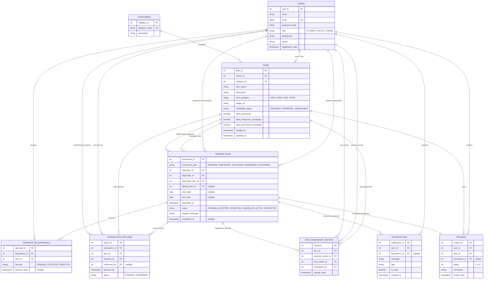

# BorrowBuddy – Entity-Relationship (ER) Diagram & Structural Analysis

## 1. System Overview & Conceptual Architecture

The **BorrowBuddy – Campus Borrow & Exchange Management Portal** database (`borrowbuddy_db`) is designed to support a multi-role, two-sided resource-sharing ecosystem. Students and faculty can list, discover, borrow temporarily, exchange temporarily, or permanently exchange campus resources (textbooks, lab gear, calculators, sports gear, etc.).

The conceptual data model is composed of **9 core entities**:
1. `USERS`
2. `CATEGORIES`
3. `ITEMS`
4. `TRANSACTIONS`
5. `TRANSACTION_APPROVALS`
6. `TRANSACTION_RETURNS`
7. `ITEM_OWNERSHIP_HISTORY`
8. `NOTIFICATIONS`
9. `REVIEWS`

---

## 2. Complete Mermaid ER Diagram

---

## 3. Detailed Relationship Narrative (19 Relationships)

### 1. `USERS` to `ITEMS` (One-to-Many: Ownership)
- **Cardinality:** `1 : N` (One user can own zero or many items; each item is owned by exactly one user at any given point in time).
- **Foreign Key:** `items.owner_id` references `users.user_id` with `ON DELETE RESTRICT`.
- **Business Logic:** When an item is listed, its owner is set to the authenticated user. Ownership remains stable throughout temporary borrowing and temporary exchanges, but is swapped atomically in permanent exchanges.

### 2. `CATEGORIES` to `ITEMS` (One-to-Many: Classification)
- **Cardinality:** `1 : N` (One category classifies zero or many items; each item belongs to exactly one category).
- **Foreign Key:** `items.category_id` references `categories.category_id` with `ON DELETE RESTRICT`.
- **Business Logic:** Deleting a category is prohibited if any item currently references it.

### 3. `USERS` to `TRANSACTIONS` (One-to-Many: Requester Role)
- **Cardinality:** `1 : N` (One user can initiate zero or many requests as the `requester`).
- **Foreign Key:** `transactions.requester_id` references `users.user_id` with `ON DELETE RESTRICT`.
- **Business Logic:** The requester cannot request their own item (`requester_id != responder_id`).

### 4. `USERS` to `TRANSACTIONS` (One-to-Many: Responder Role)
- **Cardinality:** `1 : N` (One user can be the recipient/owner in zero or many requests).
- **Foreign Key:** `transactions.responder_id` references `users.user_id` with `ON DELETE RESTRICT`.
- **Business Logic:** The responder is the owner of the requested item at the time the request is created.

### 5. `ITEMS` to `TRANSACTIONS` (One-to-Many: Requested Item)
- **Cardinality:** `1 : N` (An item can be the target of zero or many historical transactions; exactly one target item per transaction).
- **Foreign Key:** `transactions.requested_item_id` references `items.item_id` with `ON DELETE RESTRICT`.
- **Business Logic:** Checked for active/pending reservations to prevent conflicting bookings.

### 6. `ITEMS` to `TRANSACTIONS` (One-to-Many: Offered Item)
- **Cardinality:** `1 : N` (An item can be offered in zero or many exchange proposals).
- **Foreign Key:** `transactions.offered_item_id` references `items.item_id` with `ON DELETE RESTRICT`.
- **Business Logic:** Mandatory for `TEMPORARY_EXCHANGE` and `PERMANENT_EXCHANGE`; strictly `NULL` for `BORROW`.

### 7. `TRANSACTIONS` to `TRANSACTION_APPROVALS` (One-to-Many: Approval Requirements)
- **Cardinality:** `1 : N` (A transaction requires 1 approval for Borrowing, or 2 approvals for Exchanges).
- **Foreign Key:** `transaction_approvals.transaction_id` references `transactions.transaction_id` with `ON DELETE CASCADE`.
- **Business Logic:** Enables independent consent tracking without modifying the core transaction schema.

### 8. `USERS` to `TRANSACTION_APPROVALS` (One-to-Many: Decision Maker)
- **Cardinality:** `1 : N` (A user records approval decisions across multiple transactions).
- **Foreign Key:** `transaction_approvals.user_id` references `users.user_id` with `ON DELETE RESTRICT`.
- **Business Logic:** Unique constraint `(transaction_id, user_id)` prevents duplicate votes.

### 9. `TRANSACTIONS` to `TRANSACTION_RETURNS` (One-to-Many: Physical Returns)
- **Cardinality:** `1 : N` (A transaction logs 1 return for Borrowing, or 2 independent returns for Temporary Exchange).
- **Foreign Key:** `transaction_returns.transaction_id` references `transactions.transaction_id` with `ON DELETE CASCADE`.
- **Business Logic:** Temporary exchanges require both items to have confirmed return receipts before status transitions to `COMPLETED`.

### 10. `ITEMS` to `TRANSACTION_RETURNS` (One-to-Many: Returned Asset)
- **Cardinality:** `1 : N` (An item can have physical return logs across its borrowing lifecycle).
- **Foreign Key:** `transaction_returns.item_id` references `items.item_id` with `ON DELETE RESTRICT`.
- **Business Logic:** Unique constraint `(transaction_id, item_id)` prohibits duplicate return claims for the same item.

### 11. `USERS` to `TRANSACTION_RETURNS` (One-to-Many: Returned By)
- **Cardinality:** `1 : N` (A borrower logs the return of the item they had in their possession).
- **Foreign Key:** `transaction_returns.returned_by` references `users.user_id` with `ON DELETE RESTRICT`.

### 12. `USERS` to `TRANSACTION_RETURNS` (One-to-Many: Confirmed By)
- **Cardinality:** `1 : N` (The item owner confirms physical receipt).
- **Foreign Key:** `transaction_returns.confirmed_by` references `users.user_id` with `ON DELETE RESTRICT`.
- **Business Logic:** Only the verified owner of the returned item can confirm its return, restoring item availability to `AVAILABLE`.

### 13. `ITEMS` to `ITEM_OWNERSHIP_HISTORY` (One-to-Many: Transfer Audit)
- **Cardinality:** `1 : N` (An item accumulates an immutable audit record for each permanent ownership transfer).
- **Foreign Key:** `item_ownership_history.item_id` references `items.item_id` with `ON DELETE RESTRICT`.

### 14. `USERS` to `ITEM_OWNERSHIP_HISTORY` (One-to-Many: Previous Owner)
- **Cardinality:** `1 : N` (A user is recorded as previous owner across permanent transfers).
- **Foreign Key:** `item_ownership_history.previous_owner_id` references `users.user_id` with `ON DELETE RESTRICT`.

### 15. `USERS` to `ITEM_OWNERSHIP_HISTORY` (One-to-Many: New Owner)
- **Cardinality:** `1 : N` (A user is recorded as the newly acquired owner across permanent transfers).
- **Foreign Key:** `item_ownership_history.new_owner_id` references `users.user_id` with `ON DELETE RESTRICT`.

### 16. `TRANSACTIONS` to `ITEM_OWNERSHIP_HISTORY` (One-to-Many: Originating Exchange)
- **Cardinality:** `1 : N` (A permanent exchange transaction produces exactly two transfer records—one per swapped item).
- **Foreign Key:** `item_ownership_history.transaction_id` references `transactions.transaction_id` with `ON DELETE RESTRICT`.

### 17. `USERS` to `NOTIFICATIONS` (One-to-Many: User Inbox)
- **Cardinality:** `1 : N` (Each user has an inbox of system alerts, status updates, and reminders).
- **Foreign Key:** `notifications.user_id` references `users.user_id` with `ON DELETE CASCADE`.

### 18. `TRANSACTIONS` to `NOTIFICATIONS` (Zero/One-to-Many: Optional Reference)
- **Cardinality:** `0/1 : N` (Notifications link optionally to the relevant transaction).
- **Foreign Key:** `notifications.transaction_id` references `transactions.transaction_id` with `ON DELETE SET NULL`.

### 19. `USERS` to `REVIEWS` / `ITEMS` to `REVIEWS` / `TRANSACTIONS` to `REVIEWS`
- **Cardinality:**
  - `USERS` to `REVIEWS`: `1 : N` (A user can write multiple reviews for different transactions).
  - `ITEMS` to `REVIEWS`: `1 : N` (An item accumulates community ratings over time).
  - `TRANSACTIONS` to `REVIEWS`: `1 : 1` (Unique constraint: exactly one review per completed transaction).
- **Foreign Keys:**
  - `reviews.user_id` references `users.user_id`.
  - `reviews.item_id` references `items.item_id`.
  - `reviews.transaction_id` references `transactions.transaction_id` (`UNIQUE KEY`).
